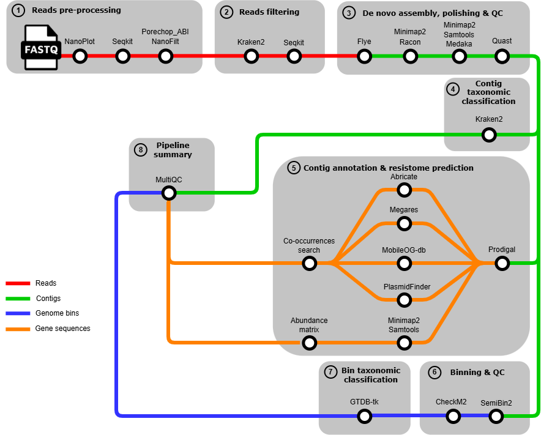

# Metagenome_Long_Read
Pipeline for microbial flora and atibiotics resistance caracterisation

## Introduction
This pipeline was developped to meet several objectives through the analysis of long-reads sequencing data using the Oxford Nanopore Technology :
- Caracterisation of the microbial flora
- Antibiotics and biocides genes research (ARG & BRG)
- Mobiles genetiques elements research (MGE)
- Co-occurrences research

The pipeline is ready to use on the Genouest Cluster but it is possible to change the configuration file.
## Table of contents
- A-Pipeline overview
- B-Compute requirements
- C-Installation
- D-Data
- E-Tools
- F-Databases

## A-Pipeline overview


## B-Pipeline stages
```
├──1-qc
│  ├──1-nanoplot
│  ├──2-quast
│  ├──3-checkm2
│  └──4-multiqc
│
├──2-trimming_filtering
│  ├──1-seqkit_fastq
│  ├──2-porechop_ABI
│  ├──3-nanofilt
│  ├──4-collect_read_id
│  └──5-seqkit
│
├──3-assembly_alignment_polishing
│  ├──1-flye
│  ├──2-minimap2_2
│  ├──3-racon_1
│  ├──4-minimap2_3
│  ├──5-racon_2
│  ├──6-minimap2_4
│  ├──7-samtools_2
│  └──8-medaka
│
├──4-binning
│  └──1-semibin2
│
├──5-annotation
│  └──1-prodigal_reads
│
├──6-abundance
│  ├──1-minimap2_1
│  └──2-samtools_1
│
├──7-taxonomie
│  ├──1-kraken2
│  ├──2-kraken2_asmbl
│  └──3-gtdbtk
│
└──8-genes_research
   ├──1-abricate
   ├──2-blast
   │  ├──1-blast_megares
   │  ├──2-blast_mobileOG
   │  └──3-blast_plasmidfinder
   ├──3-filtration_blast
   │  ├──1-filt_blast_megares
   │  └──21-filt_blast_mobileOG
   └──4-analysis_genes
```
## B-Compute requirements
Recommended compute requirements :
- CPUs : 16
- Memory : 128 GB
- Approximate run time : 24h for 3 inputs (300-700Mo)
 
## C-Intallation
Before running the entire pipeline, you need some requirements.

### CheckM2 requirements
Download the database for CheckM2 using this link :
[CheckM2 database](https://zenodo.org/record/14897628)

Create a repertory on the cluster :  
 
`mkdir databases/CheckM2_database`

Load the database on the cluster with this command line :  

`scp path/of/the/database/on/your/computer username@genossh.genouest.org:/path/on/the/cluster`

Extract the database :
```
cd databases/CheckM2_database
gunzip database_name
```

### Megares 
Download the database Megares (All sequences) using this link :
[Megares database](https://www.meglab.org/megares/download/)

Create a repertory on the cluster :  

`mkdir databases/megares_db`

Load the database on the cluster with this command line :  

`scp path/of/the/database/on/your/computer username@genossh.genouest.org:/path/on/the/cluster`

### Mobile-OG
Download the database Mobile-OG (Beatrix 1.6 v1 manually curated) using this link :
[Mobile-OG database](https://mobileogdb.flsi.cloud.vt.edu/entries/database_download)

Create a repertory on the cluster :  

`mkdir databases/mobileog_db`

Load the database on the cluster with this command line :  

`scp path/of/the/database/on/your/computer username@genossh.genouest.org:/path/on/the/cluster`

Extract the database :
```
cd databases/mobileog_db
unzip database_name
```

### PlasmidFinder requirements
Run this command line in your databases repertory :

```
#Clone database from git repository
git clone https://bitbucket.org/genomicepidemiology/plasmidfinder_db.git
cd plasmidfinder_db
#Concatenate all the databases
cat *.fsa > plasmidfinder_all.fasta
```

## D-Data
This pipeline was developped with the Nanopore GridION and PromethION Mock Microbial Community Data available on :
[Data Mockcommunity](https://github.com/LomanLab/mockcommunity)

## E-Tools

| Tools | Version | Biocontainer |
|:------|:--------|:-------------|
| [NanoPlot](https://github.com/wdecoster/nanoplot) | 1.18.4 | [Biocontainer_NanoPlot](https://quay.io/repository/biocontainers/nanoplot?tab=tags&tag=1.28.4--py_0) |
| [Porechop_ABI](https://github.com/bonsai-team/Porechop_ABI) | 0.5.1 | [Biocontainer_Porechop_ABI](https://quay.io/repository/biocontainers/quast?tab=tags&tags=5.3.0--py313pl5321h5ca1c30_2) |
| [NanoFilt](https://github.com/wdecoster/nanofilt) | 1.1.3 | [Biocontainer_NanoFilt](https://quay.io/repository/biocontainers/nanofilt?tab=tags&tag=1.1.3--py35_0) |
| [Kraken2](https://github.com/DerrickWood/kraken2) | 2.17.1 | [Biocontainer_Kraken2](https://quay.io/repository/biocontainers/kraken2?tab=tags&tags=2.17.1--pl5321h077b44d_0)
| [SeqKit](https://github.com/shenwei356/seqkit) | 2.12.0 | [Biocontainer_SeqKit](https://quay.io/repository/biocontainers/seqkit?tab=tags&tags=2.12.0--he881be0_1) |
| [Prodigal](https://github.com/hyattpd/Prodigal) | 2.6.3 | [Biocontainer_Prodigal](https://quay.io/repository/biocontainers/prodigal?tab=tags&tags=2.6.3--h577a1d6_11) |
| [Abricate](https://github.com/tseemann/abricate) | 1.2.0 | [Biocontainer_Abricate](https://quay.io/repository/biocontainers/abricate?tab=tags&tags=1.2.0--h05cac1d_0) |
| [Blast](https://github.com/JacobLondon/Blastn) | 2.17.0 | [Biocontainers_Blast](https://quay.io/repository/biocontainers/blast?tab=tags&tags=2.17.0--h66d330f_0) |
| [Flye](https://github.com/mikolmogorov/Flye) | 2.9.6 | [Biocontainers_Flye](https://quay.io/repository/biocontainers/flye?tab=tags&tags=2.9.6--py310h275bdba_0) |
| [Racon](https://github.com/lbcb-sci/racon) | 1.5.0 | [Biocontainers_Racon](https://quay.io/repository/biocontainers/racon?tab=tags&tags=1.5.0--h077b44d_6) |
| [Medaka](https://github.com/nanoporetech/medaka) | 2.0.1 | [Biocontainer_Medaka](https://hub.docker.com/layers/ontresearch/medaka/shacf8338462607b17b1d68dbce212cb93daea50bad/images/sha256-72986cff36dd0f1e55bfa76daa9c2c83d143f946255d9aff5e594e658aeb4ec5)|
| [Quast](https://github.com/ablab/quast) | 5.3.0 | [Biocontainer_Quast](https://quay.io/repository/biocontainers/quast?tab=tags&tags=5.3.0--py313pl5321h5ca1c30_2) |
| [Minimap2](https://github.com/lh3/minimap2) | 2.30 | [Biocontainer_Minimap2](https://quay.io/repository/biocontainers/minimap2?tab=tags&tags=2.30--h577a1d6_0) |
| [Samtools](https://github.com/samtools/samtools) | 1.23 | [Biocontainer_Samtools](https://quay.io/repository/biocontainers/samtools?tab=tags&tags=1.23--h96c455f_0) |
| [Semibin2](https://github.com/BigDataBiology/SemiBin) | 2.2.1 | [Biocontainer_Semibin2](https://quay.io/repository/biocontainers/semibin?tab=tags&tags=2.2.1--pyhdfd78af_0) |
| [CheckM2](https://github.com/chklovski/CheckM2) | 1.1.0 | [Biocontainer_CheckM2](https://quay.io/repository/biocontainers/checkm2?tab=tags&tags=1.1.0--pyh7e72e81_1) |
| [Gtdb-tk](https://github.com/Ecogenomics/GTDBTk) | 2.6.1 | [Biocontainer_Gtdb-tk](https://quay.io/repository/biocontainers/gtdbtk?tab=tags&tags=2.6.1--pyh1f0d9b5_2) |
| [MultiQC](https://github.com/MultiQC/MultiQC) | 1.33 | [Biocontainer_MultiQC](https://quay.io/repository/biocontainers/multiqc?tab=tags&tags=1.33--pyhdfd78af_0) |

## F-Databases

| Databases | Version |
|:----------|:--------|
| [CheckM2](https://zenodo.org/record/14897628) | 2.1.11 |
| [Kraken2_core_nt] | |
| [Megares](https://www.meglab.org/megares/download/) | 3.0.0 |
| [MobileOG](https://mobileogdb.flsi.cloud.vt.edu/entries/database_download) | Beatrix 1.6 v1 |
| [PlasmidFinder](https://bitbucket.org/genomicepidemiology/plasmidfinder_db.git) | 2.2.0 |
| [GTDBtk](https://data.gtdb.aau.ecogenomic.org/releases/latest/auxillary_files/gtdbtk_package/full_package/) | 226 |

