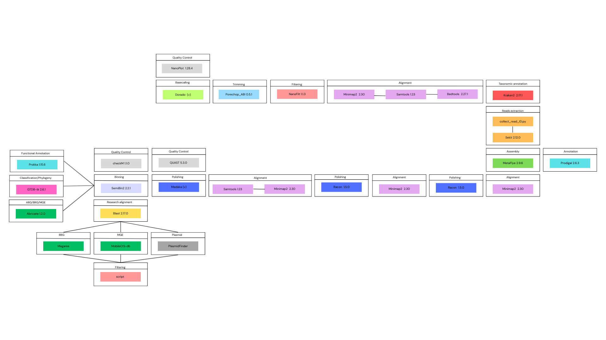

# Metagenome_Long_Read
Pipeline for microbial flora and atibiotics resistance caracterisation

## Introduction

## Table of contents

## A-Pipeline overview


## B-Compute requirements
Before running the entire pipeline, you need some requirements.

### CheckM2 requirements
Download the database for CheckM2 using this link :
[CheckM2 database](https://zenodo.org/record/14897628)

Create a repertory on the cluster :  
 
`mkdir databases/CheckM2_database`

Load the database on the cluster with this command line :  

`scp path/of/the/database/on/your/computer username@genossh.genouest.org:/path/on/the/cluster`

Extract the database :
```
cd databases/CheckM2_database
gunzip database_name
```

### Megares 
Download the database Megares (All sequences) using this link :
[Megares database](https://www.meglab.org/megares/download/)

Create a repertory on the cluster :  

`mkdir databases/Megares_database`

Load the database on the cluster with this command line :  

`scp path/of/the/database/on/your/computer username@genossh.genouest.org:/path/on/the/cluster`

### Mobile-OG
Download the database Mobile-OG (Beatrix 1.6 v1) using this link :
[Mobile-OG database](https://mobileogdb.flsi.cloud.vt.edu/entries/database_download)

Create a repertory on the cluster :  

`mkdir databases/Mobile-OG_database`

Load the database on the cluster with this command line :  

`scp path/of/the/database/on/your/computer username@genossh.genouest.org:/path/on/the/cluster`

Extract the database :
```
cd databases/Mobile-OG_database
gunzip database_name
```

### PlasmidFinder requirements
Run this command line in your databases repertory :

```
#Clone database from git repository
git clone https://bitbucket.org/genomicepidemiology/plasmidfinder_db.git
cd plasmidfinder_db
#Concatenate all the databases
cat *.fsa > plasmidfinder_all.fasta
```

## C-Data
This pipeline was developped with the Nanopore GridION and PromethION Mock Microbial Community Data available on :
[Data Mockcommunity](https://github.com/LomanLab/mockcommunity)

## D-Tools

| Tools | Version | Biocontainer |
|:------|:--------|:-------------|
| [NanoPlot](https://github.com/wdecoster/nanoplot) | 1.18.4 | [Biocontainer_NanoPlot](https://quay.io/repository/biocontainers/nanoplot?tab=tags&tag=1.28.4--py_0) |
| [Porechop_ABI](https://github.com/bonsai-team/Porechop_ABI) | 0.5.1 | [Biocontainer_Porechop_ABI](https://quay.io/repository/biocontainers/quast?tab=tags&tags=5.3.0--py313pl5321h5ca1c30_2) |
| [NanoFilt](https://github.com/wdecoster/nanofilt) | 1.1.3 | [Biocontainer_NanoFilt](https://quay.io/repository/biocontainers/nanofilt?tab=tags&tag=1.1.3--py35_0) |
| [Kraken2](https://github.com/DerrickWood/kraken2) | 2.17.1 | [Biocontainer_Kraken2](https://quay.io/repository/biocontainers/kraken2?tab=tags&tags=2.17.1--pl5321h077b44d_0)
| [SeqKit](https://github.com/shenwei356/seqkit) | 2.12.0 | [Biocontainer_SeqKit](https://quay.io/repository/biocontainers/seqkit?tab=tags&tags=2.12.0--he881be0_1) |
| [Prodigal](https://github.com/hyattpd/Prodigal) | 2.6.3 | [Biocontainer_Prodigal](https://quay.io/repository/biocontainers/prodigal?tab=tags&tags=2.6.3--h577a1d6_11) |
| [Abricate](https://github.com/tseemann/abricate) | 1.2.0 | [Biocontainer_Abricate](https://quay.io/repository/biocontainers/abricate?tab=tags&tags=1.2.0--h05cac1d_0) |
| [Blast](https://github.com/JacobLondon/Blastn) | 2.17.0 | [Biocontainers_Blast](https://quay.io/repository/biocontainers/blast?tab=tags&tags=2.17.0--h66d330f_0) |
| [Flye](https://github.com/mikolmogorov/Flye) | 2.9.6 | [Biocontainers_Flye](https://quay.io/repository/biocontainers/flye?tab=tags&tags=2.9.6--py310h275bdba_0) |
| [Racon](https://github.com/lbcb-sci/racon) | 1.5.0 | [Biocontainers_Racon](https://quay.io/repository/biocontainers/racon?tab=tags&tags=1.5.0--h077b44d_6) |
| [Medaka](https://github.com/nanoporetech/medaka) | | [Biocontainer_Medaka](https://hub.docker.com/layers/ontresearch/medaka/shacf8338462607b17b1d68dbce212cb93daea50bad/images/sha256-72986cff36dd0f1e55bfa76daa9c2c83d143f946255d9aff5e594e658aeb4ec5)|
| [Minimap2](https://github.com/lh3/minimap2) | 2.30 | [Biocontainer_Minimap2](https://quay.io/repository/biocontainers/minimap2?tab=tags&tags=2.30--h577a1d6_0) |
| [Samtools](https://github.com/samtools/samtools) | 1.23 | [Biocontainer_Samtools](https://quay.io/repository/biocontainers/samtools?tab=tags&tags=1.23--h96c455f_0) |
| [Prokka](https://github.com/tseemann/prokka) | 1.15.6 | [Biocontainer_Prokka](https://quay.io/repository/biocontainers/prokka?tab=tags&tags=1.15.6--pl5321hdfd78af_0) |

## E-Usage

